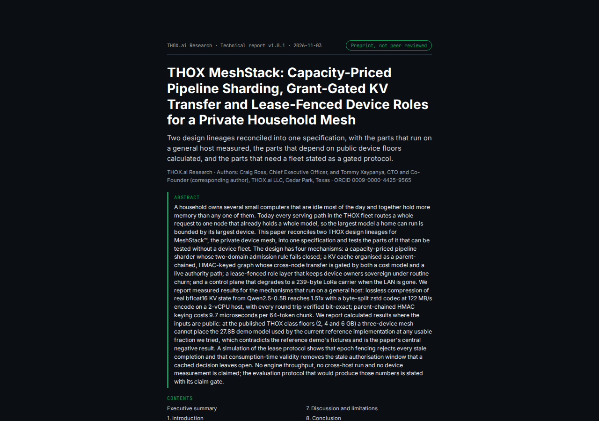

# THOX MeshStack Research Paper


**THOX MeshStack: Capacity-Priced Pipeline Sharding, Grant-Gated KV Transfer and Lease-Fenced Device Roles for a Private Household Mesh**

THOX.ai Research technical report v1.0.1 (public edition), 3 November 2026. Preprint, not peer reviewed.

Authors: **Craig Ross** and **Tommy Xaypanya** (corresponding author), THOX.ai LLC.
Tommy Xaypanya ORCID: [0009-0000-4425-9565](https://orcid.org/0009-0000-4425-9565).

This repository is the paper edition of record for the MeshStack research paper: the paper itself (PDF and HTML), its interactive companion demo, and the complete reproducibility artifact (experiment code, raw results, paper build pipeline) that produced every number in it. The paper reconciles the two MeshStack design lineages — storage-aware parallelism and the MeshStack v2 pipeline-sharding design — with the Auto Device Role Mode lease design folded in. Pipeline stage placement is priced against each node's storage and memory floors; KV cache moves between nodes only under an explicit grant; device roles are held under epoch-bearing leases so a departed holder cannot act on a stale authorisation. Results are classed honestly as measured (general host), calculated (public device floors), or simulated (protocol logic). No engine throughput, cross-host transfer, or physical-device measurement is claimed.



## Quick start

Read the paper: [`paper/THOX_MeshStack_Research_Paper_v1.0.1.pdf`](paper/THOX_MeshStack_Research_Paper_v1.0.1.pdf)
(PDF, 27 pages, SHA-256 `d071cf7102994cd698201e384672012b442d5fda26302a77f8690d4ad025d0ff`)
or [`paper/THOX_MeshStack_Research_Paper_v1.0.1.html`](paper/THOX_MeshStack_Research_Paper_v1.0.1.html)
(single-file HTML edition).

Run the companion demo: open [`paper/MeshStack_Demo_v1.0.1.html`](paper/MeshStack_Demo_v1.0.1.html)
in any browser. It is a single self-contained file; its SHA-256/HMAC
known-answer tests run in-page.

Reproduce the numbers: see [`docs/QUICKSTART.md`](docs/QUICKSTART.md) and
[`artifact/README.md`](artifact/README.md).

## Repository layout

| Path | What it is |
|---|---|
| `paper/` | The paper of record: PDF, single-file HTML, and the companion demo, all at edition v1.0.1. |
| `artifact/` | Reproducibility artifact: `exp/` experiment code and raw results (`exp/results/summary.json` is the single source for every number in the paper), `wp/` paper build pipeline (text, figures, render, QA). |
| `docs/` | `USER_GUIDE.md`, `QUICKSTART.md`, `DEVELOPMENT.md`, and rendered previews under `docs/previews/`. |
| `CITATION.cff` | Citation metadata for this paper. |
| `.agents/HANDOFF.md` | Agent handoff: status, key files, conventions, blockers. |

## Documentation map

- User guide: [`docs/USER_GUIDE.md`](docs/USER_GUIDE.md)
- Quick start / reproduction: [`docs/QUICKSTART.md`](docs/QUICKSTART.md)
- Development and build notes: [`docs/DEVELOPMENT.md`](docs/DEVELOPMENT.md)
- Agent handoff: [`.agents/HANDOFF.md`](.agents/HANDOFF.md)

## Citation

```bibtex
@techreport{thox-meshstack-2026,
  title     = {THOX MeshStack: Capacity-Priced Pipeline Sharding, Grant-Gated
               KV Transfer and Lease-Fenced Device Roles for a Private
               Household Mesh},
  author    = {Ross, Craig and Xaypanya, Tommy},
  institution = {THOX.ai Research, THOX.ai LLC},
  number    = {v1.0.1},
  year      = {2026},
  month     = nov,
  note      = {Preprint, not peer reviewed},
  url       = {https://huggingface.co/datasets/Thox-ai/thox-whitepapers}
}
```

Machine-readable citation metadata: [`CITATION.cff`](CITATION.cff).

Status identifiers, stated plainly: this paper has **no DOI and no arXiv ID
yet**. A Zenodo deposit is in preparation; when it lands, the DOI will be
added here, to `CITATION.cff`, and to the THOX Whitepapers dataset card.
The paper is also served from the
[THOX Whitepapers dataset](https://huggingface.co/datasets/Thox-ai/thox-whitepapers)
on Hugging Face (`meshstack/THOX_MeshStack_Research_Paper_v1.0.1.pdf`).

## Releases

Formal releases are cut in this repository per edition, with the paper
files attached as release assets. See the Releases page. Edition v1.0.0
was an internal confidential draft and was never published; v1.0.1 is
the first public edition.

## Agent handoff pointer

Agents resuming work on this repository start at
[`.agents/HANDOFF.md`](.agents/HANDOFF.md).

## Governance note

Public publishing (social posts, website changes, store listings, public
repository visibility changes, registries, campaigns) requires Craig
Ross's explicit approval via craig@thox.ai, CC tommy@thox.ai. This
repository's public release follows the THOX research-release process:
author consent attaches to the exact edition bytes (SHA-256 above).

## License

The paper, demo, and documentation in this repository are licensed under
the Creative Commons Attribution 4.0 International License
([CC BY 4.0](LICENSE)). The experiment and build code under `artifact/`
is included as the paper's reproducibility artifact under the same
license. See [`NOTICE.md`](NOTICE.md) for attribution and third-party
notices.
